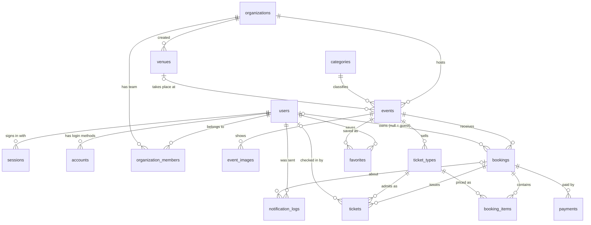

# EVENT HUB — database

**PostgreSQL 16**, accessed through Prisma 7 (`prisma/schema.prisma`).
Migrations are plain SQL in `prisma/migrations/*/migration.sql`, applied in order by `npm run db:migrate` and tracked in `_eh_migrations`.

There are 18 tables in six groups. Each one exists because a shipped or scheduled feature reads or writes it (see "Why each table exists").

## Entity–relationship diagram

`webhook_events` and `verifications` stand alone. Webhooks are keyed by provider event id, and verifications by email or token.

## Tables

| Group | Table | Purpose | Key constraints |
| --- | --- | --- | --- |
| Identity | `users` | People with an account; `role` USER or ADMIN; optional home `city` | `email` unique |
| | `sessions` | Database sessions (revocable sign-in) | `token` unique, cascade on user delete |
| | `accounts` | Login methods: password hash or OAuth provider | unique (`providerId`, `accountId`) |
| | `verifications` | Email-verification and password-reset tokens | expires |
| Organizers | `organizations` | Promoters, studios, communities; payout account for paid events | `slug` unique |
| | `organization_members` | Who can run an organization: OWNER, ADMIN, STAFF | PK (`organizationId`, `userId`) |
| Catalog | `categories` | The 7 browse categories | `slug` unique |
| | `venues` | Address, coordinates and IANA time zone | indexed by city and lat/lng |
| | `events` | Title, copy, times, status, visibility, featured window, cached min price, generated `searchVector` | `slug` unique, `endsAt >= startsAt`, GIN index on search |
| | `event_images` | Ordered photos; the first is the cover | unique (`eventId`, `sortOrder`) |
| Ticketing | `ticket_types` | Price, quantity, sold, held, per-order limits, sales window | CHECK `sold + held <= total`, CHECK price ≥ 0 |
| | `bookings` | One order: status, totals, contact, hold expiry, idempotency key; `userId` null for guests | `code` and `idempotencyKey` unique |
| | `booking_items` | Quantity and price snapshot per ticket type | unique (`bookingId`, `ticketTypeId`), quantity > 0 |
| | `tickets` | One per admission, with unguessable QR token and check-in | `qrToken` unique |
| Payments | `payments` | Provider payment per booking attempt, platform fee, refunds | `providerPaymentRef` unique |
| | `webhook_events` | Each provider webhook processed exactly once | unique (`provider`, `providerEventId`) |
| Engagement | `favorites` | Saved events for signed-in users | PK (`userId`, `eventId`) |
| | `notification_logs` | Which email went out for which booking, so retries never send twice | unique (`bookingId`, `type`, `channel`) |

## Integrity rules enforced by the database

1. Inventory: `quantitySold + quantityHeld <= quantityTotal`. Bookings decrement with one conditional `UPDATE` inside a transaction. Tested with 40 concurrent buyers for 8 seats: exactly 8 succeed.
2. Money is integer minor units plus an ISO currency code. Booking items snapshot the unit price, so later price edits never change past orders.
3. Events with bookings cannot be deleted (`ON DELETE RESTRICT`); they are cancelled instead.
4. Deleting a user keeps their bookings (`userId` becomes null) so organizer records and revenue stay correct.
5. All timestamps are `timestamptz` in UTC. Each event and venue stores its IANA zone for display.
6. Full-text search uses a generated `tsvector` over title, summary and description, with a GIN index.

## Guest bookings

People can book without an account. The booking stores the contact email and `userId = null`. When an account verifies that email address, its guest bookings are attached to it, so nobody is locked out of signing up with an email they once booked with.

## Why each table exists

- **Discovery:** categories, venues, events, event_images
- **Booking and tickets:** ticket_types, bookings, booking_items, tickets
- **Accounts:**
  - users, sessions, accounts and verifications (sign-in)
  - favorites (saved events)
  - organizations and organization_members (organizer studio and permissions)
- **Payments:** payments, webhook_events
- **Reminders and confirmations:** notification_logs

Removed in migration 0002 because no feature uses them:
- the `reviews` table
- marketing opt-in
- category icon key
- organization cover image
- venue address line 2
- event-level capacity (ticket types already cap it)
- image blur placeholder and cover flag

## PostgreSQL or MongoDB

| Requirement from the app | PostgreSQL | MongoDB |
| --- | --- | --- |
| Never oversell a ticket under concurrent bookings | Row-level conditional `UPDATE` plus a CHECK constraint, in an ordinary transaction | Possible with conditional `updateOne` or multi-document transactions, but no declarative CHECK across fields |
| Orders, items, tickets and payments must stay consistent | Foreign keys, cascades and RESTRICT are enforced by the engine | References are not enforced; the application must maintain them |
| Event cards join event, venue, organizer, category and inventory | Native joins in one query | `$lookup` pipelines or duplicated data that must be kept in sync |
| Trending: tickets plus saves in the last 7 days | One SQL aggregate | Aggregation pipeline; workable |
| Search by text, city, date and price | Built-in full-text search with GIN index; B-tree on dates and prices | Text indexes (one per collection) or Atlas Search |
| Flexible fields, such as event-specific extras later | `JSONB` columns when needed | Native strength |
| Money and reporting for organizers | Exact integers, SQL reporting | Workable, weaker ad-hoc reporting |
| Hosting | Neon, Supabase, Render, RDS | Atlas |

**Recommendation: PostgreSQL.** EVENT HUB's core is relational and transactional: inventory, orders, tickets and payments must agree with each other at all times. PostgreSQL enforces that in the database itself. MongoDB's advantage, schema flexibility, is not something this product needs, and `JSONB` covers it if it ever does.
